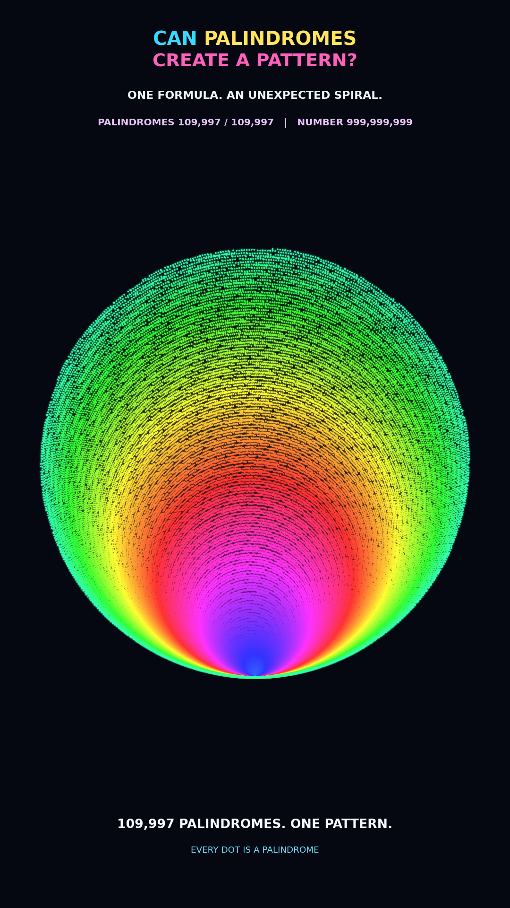

# Palindrome Geometry — One Billion Number Experiment

**109,997 palindromic numbers. Two trigonometric equations. One striking geometric visualization.**

This project explores what happens when every palindromic integer from **2 through 1,000,000,000** is mapped to a point in the plane. The resulting animation reveals a colorful, intricate arrangement of curves — generated entirely from the selected numbers and a deterministic mathematical transformation.



## The mathematics

A **palindrome** reads the same forward and backward, for example `11`, `101`, or `12321`.

For each palindromic integer `n`, the program computes:

$$
x(n) = n \sin(n) \cos(n)
$$

$$
y(n) = n \sin^2(n)
$$

All trigonometric functions use **radians**. Every plotted dot represents exactly one palindrome. The point coordinates are computed directly from these equations; the colors and glow are visual styling.

The pattern is a visualization of **palindromic numbers under this particular mapping**. It is not a claim that palindromes inherently form this shape under every representation.

## Experiment at a glance

| Setting | Value |
| --- | --- |
| Range | `2` to `1,000,000,000` (inclusive) |
| Palindromes plotted | **109,997** |
| Largest palindrome plotted | `999,999,999` |
| Video format | Vertical, `1080 × 1920` |
| Duration | `60` seconds |
| Frame rate | `30 FPS` |
| Libraries | NumPy, Matplotlib |
| Video encoder | FFmpeg (H.264) |

The script generates palindromes directly by mirroring digit prefixes, rather than checking all one billion integers one by one.

## Quick start

**Requirements:** Python 3.9+ (recommended), NumPy, Matplotlib. FFmpeg is required **only** to export an MP4.

1. Download or clone this repository.
2. Install the Python dependencies:

   ```bash
   python -m pip install -r requirements.txt
   ```

3. Open `palindrome_reveal.py` and set:

   ```python
   MAX_N = 1_000_000_000
   PREVIEW_ONLY = True
   PREVIEW_SECOND = 55.0
   ```

4. Generate a single-frame preview:

   ```bash
   python palindrome_reveal.py
   ```

5. To render the **full silent video**, install FFmpeg and change:

   ```python
   PREVIEW_ONLY = False
   ```

   Then run the same Python command again. The script saves `palindrome_reveal_1000000000.mp4` to the current working directory.

> **Performance:** Rendering 1,800 full-HD frames may take considerable time. Test with `PREVIEW_ONLY = True` first. The one-billion setting refers to the upper limit of the integer range, **not** to one billion rendered dots.

## Animation sequence

- **0–3 seconds:** Reveal the complete pattern as an opening hook.
- **3–5.5 seconds:** Restart with the earliest palindromes.
- **5.5–50 seconds:** Build the visualization with a dynamically adjusting camera.
- **50–60 seconds:** Show the complete result.

The animation intentionally has no coordinate axes. A colored point cloud and minimal text overlays keep the focus on the mathematics.

## Narration and YouTube

This repository contains the **visualization code**, not the narrated soundtrack. The documentary-style English voice-over was added separately during video post-production. You can combine the exported MP4 with your own audio using any video editor or FFmpeg.

## Project structure

```text
palindrome-geometry-one-billion/
├── README.md
├── palindrome_reveal.py
├── requirements.txt
├── .gitignore
└── assets/
    └── preview.png
```

## Reproducibility notes

- Palindromes are generated as integers and converted to NumPy `float64` for the trigonometric calculations.
- The sequence includes palindromes starting from `2`; `0` and `1` are excluded.
- The number of palindromes in the selected range is **109,997**.
- The visual color progression is decorative and does not encode a separate mathematical property.
- The project is an artistic mathematical visualization, not a proof of a new theorem about palindromes.

## Contributing

Suggestions, reproducibility reports, and experiments with alternative number sequences or coordinate mappings are welcome via GitHub Issues.
